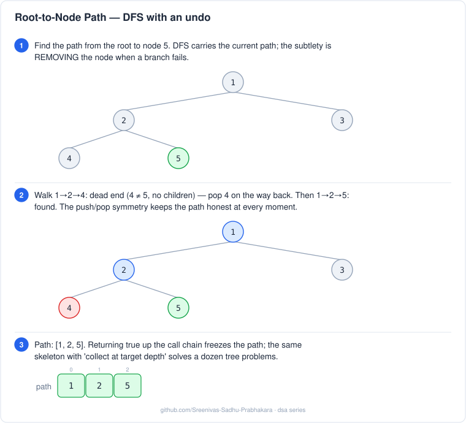

# Root-to-Node Path in a Binary Tree

> Striver SDE Sheet 114 · Day 17 Binary Tree — DFS that appends on entry and truncates on failed return; whatever survives is the path. Go, stdlib only, tested.

## Problem

Return the sequence of values from the root to a given node in a binary tree (no BST ordering to steer by — both subtrees may need exploring).

## Approach

Backtracking in its minimal form. Push the current node onto a shared path, succeed if it's the target, otherwise try both children; if neither subtree finds it, pop — the node is provably not on the answer path. The invariant that makes it correct: at any moment the path holds exactly the chain from the root to the node under consideration. A found target returns true up the whole call chain, freezing the path mid-walk. This exact shape, with the path replaced by other accumulated state, powers LCA variants, path-sum problems, and distance-between-nodes.

**Complexity:** O(n) time, O(h) path and stack.

## Visual walkthrough

Read the picture top to bottom — each numbered frame is one moment of the algorithm
running on this repo's test example.

## Run

    go test ./...   # verify
    go run .        # demo

---

One of 191 repos solving Striver's SDE Sheet in Go — stdlib only, one problem per repo, every solution tested. Browse the set: [`dsa-*` repos](https://github.com/Sreenivas-Sadhu-Prabhakara?tab=repositories&q=dsa-&type=source).
